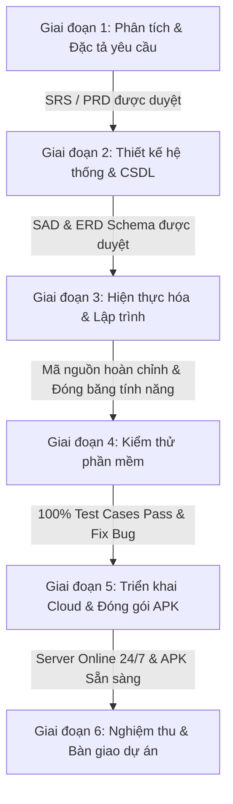
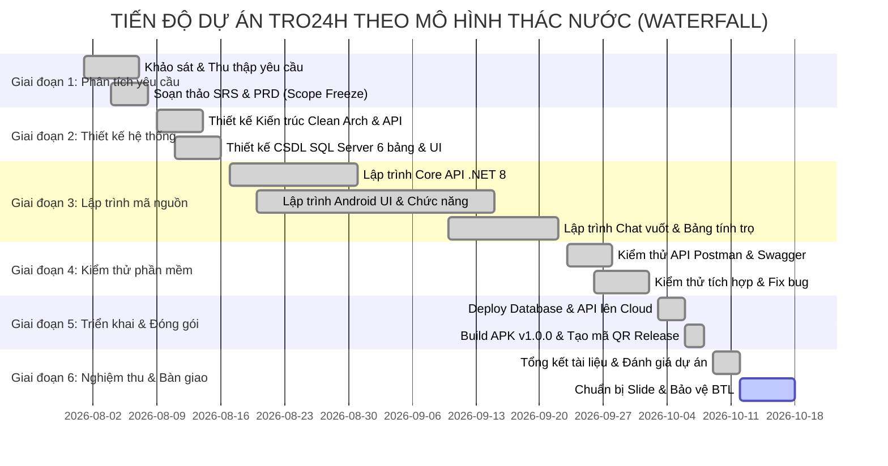

# KẾ HOẠCH PHÂN CÔNG CÔNG VIỆC & TIẾN ĐỘ DỰ ÁN TRO24H
**Học phần:** Triển khai dự án phần mềm (Mã chuyên đề: ST-01)  
**Dự án:** Hệ thống ứng dụng di động tìm kiếm và quản lý phòng trọ sinh viên TRO24H  
**Mô hình phát triển:** **Mô hình Thác Nước (Waterfall Model - Tuyến tính tuần tự)**  
**Kho lưu trữ & Quản lý tiến độ GitHub:** [https://github.com/Dinh-Phuong1001/TRO24H](https://github.com/Dinh-Phuong1001/TRO24H)

---

## 1. NGUYÊN TẮC ÁP DỤNG MÔ HÌNH THÁC NƯỚC (WATERFALL)
Dự án **TRO24H** được tổ chức và quản lý theo **Mô hình Thác Nước cổ điển (Classic Waterfall Model)** với các đặc trưng cốt lõi:
1. **Tính tuần tự (Sequential Flow):** Dự án chia làm 6 giai đoạn rõ ràng. Mỗi giai đoạn chỉ được bắt đầu khi giai đoạn trước đó đã hoàn thành và được nghiệm thu.
2. **Cổng kiểm soát chất lượng (Phase Exit Gate):** Mỗi giai đoạn đều có **Đầu vào (Inputs)**, **Nhiệm vụ trọng tâm (Key Tasks)**, **Sản phẩm bàn giao (Deliverables)** và **Tiêu chí nghiệm thu (Exit Criteria)**.
3. **Tính toàn vẹn tài liệu (Document-driven):** Mọi quyết định kỹ thuật, kiến trúc CSDL và giao diện đều được tài liệu hóa chi tiết trước khi lập trình, giảm thiểu tối đa rủi ro thay đổi kiến trúc ở các giai đoạn sau.

---

## 2. CƠ CẤU NHÓM & VAI TRÒ DỰ ÁN

| STT | Họ và tên | Vai trò chính | Nhiệm vụ đảm nhiệm |
|:---:|:---|:---|:---|
| 1 | **Trưởng nhóm (PM)** | Project Manager & Architect | • Lập kế hoạch dự án tổng thể, xác lập Milestone và kiểm soát tiến độ từng giai đoạn. • Phê duyệt tài liệu đặc tả (SRS), tài liệu kiến trúc (SAD) và nghiệm thu chuyển pha. • Quản trị rủi ro và điều phối phân công công việc trên GitHub Issues. |
| 2 | **Lập trình viên Mobile (Lead)** | Android Native Developer | • Thiết kế khung kiến trúc Clean Architecture + MVVM trên Android Studio. • Lập trình các màn hình chính: Splash, Login, Register, Home, RoomDetail. • Tích hợp thư viện Retrofit, OkHttp, Coil, ViewBinding. |
| 3 | **Lập trình viên Mobile 2** | Android Feature Developer | • Lập trình tính năng Tìm kiếm thời gian thực & Bộ lọc nâng cao (Filter). • Lập trình giao diện Chat 1-1 (`ChatActivity`, cử chỉ vuốt Ghim / Chặn / Xóa). • Xử lý lưu trữ phiên người dùng với `UserSessionManager` (DataStore) và Google Maps. |
| 4 | **Lập trình viên Backend** | Backend & API Developer | • Xây dựng máy chủ ASP.NET Core 8.0 Web API theo mô hình RESTful Service. • Hiện thực các Controller: `AuthController`, `RoomController`, `ChatController`. • Tích hợp tài liệu OpenAPI/Swagger UI, cấu hình CORS và bảo mật xác thực. |
| 5 | **Kỹ sư Cơ sở dữ liệu & DevOps** | Database Admin & DevOps | • Thiết kế lược đồ CSDL MS SQL Server (6 bảng quan hệ, ràng buộc toàn vẹn khóa ngoại). • Viết script nạp dữ liệu mẫu (Seed Data) và tối ưu chỉ mục (Indexes). • Triển khai Backend và Database lên hạ tầng đám mây MonsterASP Cloud 24/7. |
| 6 | **Kiểm thử viên (QA/QC)** | Tester & Technical Writer | • Soạn thảo Kế hoạch kiểm thử (Test Plan), thiết kế ma trận Test Cases. • Kiểm thử chức năng API qua Postman/Swagger, kiểm thử hộp đen trên thiết bị thật. • Soạn thảo Tài liệu đặc tả yêu cầu (SRS) và Hồ sơ nghiệm thu dự án. |

---

## 3. MA TRẬN PHÂN CÔNG TRÁCH NHIỆM (RACI MATRIX)
* **R (Responsible):** Người trực tiếp thực hiện công việc.
* **A (Accountable):** Người chịu trách nhiệm cao nhất và phê duyệt kết quả.
* **C (Consulted):** Người được tham vấn chuyên môn kỹ thuật.
* **I (Informed):** Người được thông báo kết quả.

| Các giai đoạn theo Mô hình Thác Nước | PM | Mobile Lead | Mobile Dev 2 | Backend Dev | DB / DevOps | QA / Tester |
|:---|:---:|:---:|:---:|:---:|:---:|:---:|
| **Giai đoạn 1:** Phân tích & Đặc tả yêu cầu | **A** | C | C | C | C | **R** |
| **Giai đoạn 2:** Thiết kế hệ thống & CSDL | **A** | **R** | C | **R** | **R** | I |
| **Giai đoạn 3:** Hiện thực hóa & Lập trình | A | **R** | **R** | **R** | C | I |
| **Giai đoạn 4:** Kiểm thử phần mềm (QA) | A | C | C | C | I | **R** |
| **Giai đoạn 5:** Triển khai Cloud & Đóng gói | A | **R** | I | C | **R** | C |
| **Giai đoạn 6:** Nghiệm thu & Bàn giao | **A** | C | C | C | C | **R** |

---

## 4. CHI TIẾT CÁC GIAI ĐOẠN PHÁT TRIỂN (WATERFALL PHASES)

### 🌊 Giai đoạn 1: Phân tích & Đặc tả yêu cầu (Requirements Analysis)
* **Thời gian thực hiện:** Tuần 1
* **Đầu vào (Inputs):** Khảo sát thực tế nhu cầu tìm trọ của sinh viên (giá, an ninh, vị trí gần trường) và khó khăn của chủ trọ.
* **Nhiệm vụ trọng tâm:**
  - [x] Thu thập và phân loại yêu cầu chức năng (Functional Requirements) và phi chức năng (Non-functional Requirements).
  - [x] Xác định các vai trò người dùng: Khách vãng lai, Sinh viên thuê trọ, Chủ phòng trọ.
  - [x] Lập mô hình Use Case tổng quát và kịch bản chi tiết cho từng tác nhân.
  - [x] Soạn thảo tài liệu Product Requirements Document (`01_PRD.md`) và Báo cáo đặc tả yêu cầu (`BaoCao_DacTaYeuCau_Tro24H_Moi.docx`).
* **Sản phẩm bàn giao (Deliverables):**
  - Tài liệu `docs/01_PRD.md` hoàn chỉnh.
  - Báo cáo đặc tả yêu cầu phần mềm có chữ ký xác nhận của PM.
* **Tiêu chí nghiệm thu (Phase Exit Gate):** Phạm vi dự án được đóng băng (Scope Freeze), không thay đổi yêu cầu chức năng cốt lõi.

---

### 🌊 Giai đoạn 2: Thiết kế hệ thống & Cơ sở dữ liệu (System & UI/UX Design)
* **Thời gian thực hiện:** Tuần 2
* **Đầu vào (Inputs):** Tài liệu đặc tả yêu cầu (SRS/PRD) đã được phê duyệt ở Giai đoạn 1.
* **Nhiệm vụ trọng tâm:**
  - [x] **Thiết kế kiến trúc phần mềm:** Chọn mô hình Clean Architecture + MVVM cho Android; mô hình 3-Tier Layered RESTful Web API cho ASP.NET Core 8.
  - [x] **Thiết kế Cơ sở dữ liệu:** Thiết kế mô hình thực thể ERD và bảng quan hệ MS SQL Server gồm 6 bảng: `Users`, `Rooms`, `SavedRooms`, `ViewHistories`, `ChatSessions`, `Messages`.
  - [x] **Thiết kế hợp đồng giao tiếp (API Contracts):** Định nghĩa 15 RESTful endpoints, cấu trúc JSON Request/Response và quy ước mã lỗi HTTP.
  - [x] **Thiết kế giao diện (UI/UX):** Phác thảo Wireframe và Style Guide phong cách trẻ trung hiện đại (Gen Z Palette: Indigo, Emerald, Amber).
* **Sản phẩm bàn giao (Deliverables):**
  - Tài liệu kiến trúc hệ thống (`docs/02_KienTrucHeThong.md`).
  - Script DDL tạo bảng CSDL và quan hệ ràng buộc (`UniStayDbContext.cs`).
* **Tiêu chí nghiệm thu (Phase Exit Gate):** Lược đồ CSDL chuẩn hóa (3NF), thiết kế API được duyệt 100%.

---

### 🌊 Giai đoạn 3: Hiện thực hóa & Lập trình (Implementation / Coding)
* **Thời gian thực hiện:** Tuần 3 - Tuần 6
* **Đầu vào (Inputs):** Tài liệu kiến trúc, lược đồ CSDL và hợp đồng API đã đóng băng từ Giai đoạn 2.
* **Nhiệm vụ trọng tâm:**
  - [x] **Lập trình Backend Web API:**
    - Khởi tạo dự án ASP.NET Core 8.0 C#, tích hợp Entity Framework Core.
    - Viết `AuthController` (Đăng ký, Đăng nhập, mã hóa BCrypt, phân quyền Sinh viên / Chủ trọ).
    - Viết `RoomController` (Danh sách phòng, tìm kiếm theo trường ĐH, chi tiết phòng, bộ lọc).
    - Viết `ChatController` (Khởi tạo phiên chat, danh sách hội thoại, gửi/nhận tin nhắn).
    - Tích hợp Swagger UI để phục vụ kiểm thử nội bộ.
  - [x] **Lập trình Ứng dụng di động Android Native:**
    - Thiết lập Clean Architecture: tầng `domain`, `data`, `presentation`, `di`.
    - Lập trình màn hình Xác thực: `SplashActivity`, `LoginActivity`, `RegisterActivity`, quản lý phiên qua `UserSessionManager`.
    - Lập trình Trang chủ & Tìm kiếm: `HomeFragment`, `RoomAdapter`, `FilterBottomSheetDialog` (lọc theo trường UTC, FTU, NEU..., khoảng giá, tiện ích).
    - Lập trình Chi tiết phòng: `RoomDetailActivity`, thư viện tải ảnh `Coil`, tính năng Bảng dự toán chi phí trọ thông minh, chỉ đường Google Maps.
    - Lập trình Module Chat 1-1: `ChatActivity`, bong bóng tin nhắn đối xứng, cử chỉ vuốt thẻ tin nhắn để **Ghim**, **Chặn**, **Xóa**, tự động đẩy tin nhắn mới nhất lên đầu danh sách.
* **Sản phẩm bàn giao (Deliverables):**
  - Toàn bộ mã nguồn Backend C# và Mobile Kotlin được đẩy lên kho lưu trữ GitHub.
* **Tiêu chí nghiệm thu (Phase Exit Gate):** Toàn bộ mã nguồn biên dịch thành công 0 lỗi cú pháp, tính năng hoạt động đầy đủ theo đặc tả.

---

### 🌊 Giai đoạn 4: Kiểm thử phần mềm (Testing & Verification)
* **Thời gian thực hiện:** Tuần 7
* **Đầu vào (Inputs):** Hệ thống Backend API và bản cài đặt Android build từ mã nguồn Giai đoạn 3.
* **Nhiệm vụ trọng tâm:**
  - [x] **Kiểm thử API (API Testing):** Thực hiện kiểm thử toàn bộ 15 API endpoints qua Swagger và Postman Collection. Kiểm tra mã trạng thái HTTP (200, 400, 401, 404, 500).
  - [x] **Kiểm thử tích hợp (Integration Testing):** Kiểm tra khả năng đồng bộ dữ liệu giữa Android và Backend API.
  - [x] **Kiểm thử chức năng (Functional Testing):** Thực thi ma trận Test Cases cho toàn bộ các luồng: Đăng ký -> Đăng nhập -> Duyệt phòng -> Lọc -> Xem chi tiết -> Dự toán -> Nhắn tin chủ trọ.
  - [x] **Kiểm thử độ tin cậy & Xử lý ngoại lệ:** Kiểm tra ứng dụng khi mất kết nối mạng (Network Timeout), nhập sai dữ liệu định dạng, phòng hết chỗ.
  - [x] **Khắc phục lỗi (Bug Fixing):** Fix triệt để các lỗi phát sinh, tối ưu tốc độ cuộn `RecyclerView` đạt 60fps.
* **Sản phẩm bàn giao (Deliverables):**
  - Báo cáo kết quả kiểm thử (Test Execution Report).
  - 100% Test Cases vượt qua (Pass), không còn lỗi nghiêm trọng (Critical/High Bugs).
* **Tiêu chí nghiệm thu (Phase Exit Gate):** Biên bản nghiệm thu kiểm thử phần mềm được phê duyệt.

---

### 🌊 Giai đoạn 5: Triển khai Cloud & Đóng gói APK (Deployment & Release)
* **Thời gian thực hiện:** Tuần 8
* **Đầu vào (Inputs):** Mã nguồn đã vượt qua kiểm thử chất lượng ở Giai đoạn 4.
* **Nhiệm vụ trọng tâm:**
  - [x] **Triển khai Cơ sở dữ liệu Cloud:** Khởi tạo MS SQL Server trên hạ tầng đám mây MonsterASP (`db69654.databaseasp.net`), chạy script tạo bảng và nạp 20 dữ liệu mẫu chuẩn thực tế.
  - [x] **Triển khai Backend Cloud:** Triển khai ASP.NET Core 8 API lên MonsterASP Cloud (`http://tro24h.runasp.net`), cấu hình CORS và chuỗi kết nối an toàn.
  - [x] **Đồng bộ ứng dụng di động:** Cập nhật `BASE_URL` trong mã nguồn Android sang domain máy chủ Cloud 24/7.
  - [x] **Đóng gói phát hành (Release Build):** Build bản phát hành APK chính thức `TRO24H-v1.0.0.apk`.
  - [x] **Xuất bản Release & Mã QR:** Đăng tải bản phát hành lên [GitHub Releases v1.0.0](https://github.com/Dinh-Phuong1001/TRO24H/releases/tag/v1.0.0) và tạo mã QR tải nhanh phục vụ người dùng.
* **Sản phẩm bàn giao (Deliverables):**
  - Dịch vụ Web API & Database trực tuyến 24/7 tại `http://tro24h.runasp.net/swagger`.
  - Bản cài đặt `TRO24H-v1.0.0.apk` và mã QR tải trực tiếp.
* **Tiêu chí nghiệm thu (Phase Exit Gate):** Người dùng bất kỳ có thể quét mã QR, cài đặt APK và sử dụng đầy đủ tính năng qua mạng 4G/5G/Wifi độc lập.

---

### 🌊 Giai đoạn 6: Nghiệm thu & Bàn giao dự án (Maintenance & Handover)
* **Thời gian thực hiện:** Tuần 9
* **Đầu vào (Inputs):** Toàn bộ sản phẩm phần mềm hoạt động thực tế trên Cloud và bộ hồ sơ tài liệu dự án.
* **Nhiệm vụ trọng tâm:**
  - [x] Tổng hợp số liệu vận hành, đánh giá mức độ đáp ứng mục tiêu ban đầu.
  - [x] Biên soạn tài liệu Hướng dẫn sử dụng và Vận hành hệ thống.
  - [ ] Chuẩn bị Slide báo cáo bảo vệ Đồ án / Bài tập lớn môn học.
  - [ ] Tổ chức buổi demo trực tiếp ứng dụng trước hội đồng đánh giá.
* **Sản phẩm bàn giao (Deliverables):**
  - Bộ hồ sơ tài liệu hoàn chỉnh: PRD, Kiến trúc, Phân công tiến độ, Tài liệu đặc tả.
  - Slide thuyết trình bảo vệ dự án.
  - Biên bản nghiệm thu toàn diện sản phẩm.
* **Tiêu chí nghiệm thu (Phase Exit Gate):** Hội đồng nghiệm thu và giảng viên đánh giá thông qua dự án.

---

## 5. BIỂU ĐỒ TIẾN ĐỘ THÁC NƯỚC (GANTT CHART)

---

## 6. THEO DÕI TIẾN ĐỘ THỰC TẾ TRÊN GITHUB (MILESTONES & ISSUES)

Dự án đã được số hóa và đồng bộ 100% lên GitHub theo đúng 6 giai đoạn của Mô hình Thác Nước:

* **Danh sách Milestones Thác Nước:** [https://github.com/Dinh-Phuong1001/TRO24H/milestones](https://github.com/Dinh-Phuong1001/TRO24H/milestones)
* **Bảng công việc (GitHub Issues):** [https://github.com/Dinh-Phuong1001/TRO24H/issues](https://github.com/Dinh-Phuong1001/TRO24H/issues)

| Milestone | Tên giai đoạn Thác Nước | Số lượng công việc (Issues) | Trạng thái tiến độ |
|:---:|:---|:---:|:---:|
| **#1** | Giai đoạn 1: Phân tích & Đặc tả yêu cầu | 1 Issue (#14) | **100% Hoàn thành** |
| **#2** | Giai đoạn 2: Thiết kế hệ thống & CSDL | 2 Issues (#1, #3) | **100% Hoàn thành** |
| **#3** | Giai đoạn 3: Hiện thực hóa & Lập trình | 8 Issues (#2, #4, #5, #6, #7, #8, #9, #10) | **100% Hoàn thành** |
| **#4** | Giai đoạn 4: Kiểm thử phần mềm | 1 Issue (#15) | **100% Hoàn thành** |
| **#5** | Giai đoạn 5: Triển khai Cloud & Đóng gói APK | 2 Issues (#11, #12) | **100% Hoàn thành** |
| **#6** | Giai đoạn 6: Nghiệm thu & Bàn giao dự án | 1 Issue (#13) | **Đang thực hiện (In Progress)** |

---

## 7. TIÊU CHUẨN ĐÁNH GIÁ CHẤT LƯỢNG (QUALITY GATES)
1. **Kiến trúc & Mã nguồn:** Tuân thủ triệt để Clean Architecture + MVVM, không có mã lỗi (Zero Compilation Error).
2. **Cơ sở dữ liệu:** Lược đồ quan hệ chuẩn hóa 3NF, 100% bảng có khóa chính và khóa ngoại toàn vẹn dữ liệu.
3. **Backend API:** Phản hồi chuẩn RESTful JSON, tài liệu hóa với Swagger UI, hỗ trợ xử lý ngoại lệ toàn cục.
4. **Ứng dụng di động:** Giao diện trực quan phong cách Gen Z, thao tác vuốt thẻ mượt mà 60fps, tương thích Android 7.0 - 14.
5. **Đám mây & Triển khai:** Hệ thống vận hành online 24/7 trên Cloud công cộng, người dùng tải và cài đặt trực tiếp qua file APK hoặc quét mã QR.
