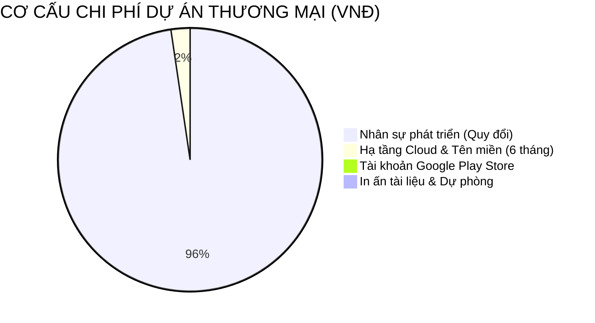

# BÁO CÁO DỰ TOÁN CHI PHÍ & NGÂN SÁCH DỰ ÁN TRO24H
**Học phần:** Triển khai dự án phần mềm (Mã chuyên đề: ST-01)  
**Tên dự án:** Ứng dụng di động tìm kiếm và quản lý phòng trọ sinh viên TRO24H  
**Mô hình phát triển:** Mô hình Thác Nước (Waterfall Model - 6 giai đoạn, 9 tuần)  
**Thời gian lập dự toán:** Năm 2026  

---

## 1. PHƯƠNG PHÁP LUẬN TÍNH TOÁN CHI PHÍ
Dự toán chi phí dự án **TRO24H** được xây dựng dựa trên:
1. **Phương pháp ước lượng từ dưới lên (Bottom-up Cost Estimation):** Phân rã chi phí chi tiết theo cấu trúc phân rã công việc (WBS) và 6 giai đoạn Thác Nước trong tài liệu `05_PhanCongCongViec_TienDo.md`.
2. **Phương pháp định mức công nhật / tháng công (Man-Month / Man-Day):** Căn cứ theo mặt bằng lương lập trình viên tại thị trường Việt Nam (Junior - Mid-level) và định mức chi phí phần mềm theo hướng dẫn của Bộ Thông tin & Truyền thông.
3. **Phân tách 2 kịch bản ngân sách rõ ràng:**
   - **Kịch bản 1: Định giá thương mại phần mềm (Commercial Valuation):** Áp dụng khi doanh nghiệp thuê phát triển dự án hoặc báo cáo định giá tổng thể Bài tập lớn / Đồ án.
   - **Kịch bản 2: Chi phí thực tế nhóm sinh viên triển khai (Actual Out-of-Pocket Cost):** Ngân sách tiền mặt thực tế tối thiểu để dự án chạy online 24/7 và phát hành đến tay người dùng.

---

## 2. DỰ TOÁN THEO KỊCH BẢN 1: ĐỊNH GIÁ THƯƠNG MẠI PHẦN MỀM (COMMERCIAL VALUATION)

Thời gian dự án: **9 tuần (~ 2.25 tháng)**  
Quy mô nhân sự: **6 thành viên chuyên trách**

### 2.1. Chi phí nhân sự phát triển (Human Resources Cost)

| STT | Vị trí công việc | Số lượng | Mức thù lao (VNĐ/tháng) | Thời gian tham gia | Thành tiền (VNĐ) |
|:---:|:---|:---:|:---:|:---:|:---:|
| 1 | **Project Manager & Solution Architect** (Quản lý dự án & Kiến trúc sư hệ thống) | 1 | 20.000.000 | 2.25 tháng (100%) | 45.000.000 |
| 2 | **Lead Android Developer** (Lập trình viên Mobile chính) | 1 | 16.000.000 | 2.0 tháng (Pha 2-5) | 32.000.000 |
| 3 | **Android Feature Developer** (Lập trình viên Mobile tính năng) | 1 | 12.000.000 | 1.75 tháng (Pha 3-5) | 21.000.000 |
| 4 | **Backend .NET 8 Developer** (Lập trình viên máy chủ & API) | 1 | 15.000.000 | 1.75 tháng (Pha 2-5) | 26.250.000 |
| 5 | **Database Administrator & DevOps** (Quản trị CSDL & Triển khai Cloud) | 1 | 14.000.000 | 1.5 tháng (Pha 2, 3, 5) | 21.000.000 |
| 6 | **QA / Tester & Technical Writer** (Kiểm thử viên & Soạn thảo tài liệu) | 1 | 10.000.000 | 2.0 tháng (Pha 1, 4, 6) | 20.000.000 |
| **TỔNG** | **Tổng chi phí nhân sự cơ bản (Direct Labor Cost):** | **6 người** | | | **165.250.000** |

> *Ghi chú:* Đối với quy mô sinh viên / đồ án học thuật áp dụng hệ số hỗ trợ học tập (0.5), chi phí nhân sự quy đổi tương đương: **~ 82.600.000 VNĐ**.

---

### 2.2. Chi phí Hạ tầng Đám mây & Dịch vụ trực tuyến (Cloud Infrastructure)

Tính cho giai đoạn chạy thử nghiệm & vận hành 6 tháng đầu tiên:

| STT | Dịch vụ đám mây | Nhà cung cấp | Thông số kỹ thuật | Đơn giá / tháng | Thành tiền (6 tháng) |
|:---:|:---|:---|:---|:---:|:---:|
| 1 | **Web API Hosting (.NET 8)** | MonsterASP / Azure | 1 Core CPU, 1GB RAM, SSD, 99.9% Uptime | 150.000 VNĐ | 900.000 VNĐ |
| 2 | **Cloud MS SQL Server** | MonsterASP Database | 500MB - 1GB Storage, Auto Backup | 120.000 VNĐ | 720.000 VNĐ |
| 3 | **Cloud Storage (Ảnh phòng trọ)** | Cloudinary / Firebase | 10GB lưu trữ, CDN tối ưu ảnh tải nhanh | 0 VNĐ (Gói Free Tier) | 0 VNĐ |
| 4 | **Bản đồ số Google Maps API** | Google Cloud Platform | 28.000 lượt load map/tháng (Free Credit $200) | 0 VNĐ (Trong hạn mức) | 0 VNĐ |
| 5 | **Tên miền riêng (Domain)** | iNET / Mắt Bão | Tên miền quốc tế `.com` hoặc `.vn` (1 năm) | 350.000 VNĐ / năm | 350.000 VNĐ |
| 6 | **Chứng chỉ bảo mật SSL/TLS** | Let's Encrypt / Cloudflare | Mã hóa HTTPS 256-bit | Miễn phí | 0 VNĐ |
| **TỔNG** | **Tổng chi phí hạ tầng (6 tháng):** | | | | **1.970.000 VNĐ** |

---

### 2.3. Chi phí Bản quyền, Giấy phép & Thiết bị (Licenses & Accounts)

| STT | Danh mục | Mục đích sử dụng | Hình thức thanh toán | Thành tiền (VNĐ) |
|:---:|:---|:---|:---|:---:|
| 1 | **Tài khoản Google Play Console** | Xuất bản và phân phối app Android lên CH Play | Phí một lần duy nhất ($25) | 630.000 |
| 2 | **Môi trường phát triển IDE** | Android Studio, Visual Studio Community, VS Code | Bản quyền giáo dục / Cộng đồng | 0 |
| 3 | **Hệ thống quản lý mã nguồn GitHub** | Lưu trữ Repo, GitHub Issues, GitHub Releases | GitHub Free Tier | 0 |
| 4 | **Công cụ thiết kế UI/UX** | Figma (Thiết kế giao diện, Wireframe) | Figma Free Tier | 0 |
| 5 | **Công cụ kiểm thử Postman** | Kiểm thử 15 RESTful API endpoints | Postman Free Tier | 0 |
| **TỔNG** | **Tổng chi phí giấy phép & công cụ:** | | | **630.000 VNĐ** |

---

### 2.4. Chi phí Quản lý, Kiểm thử & Dự phòng rủi ro

| STT | Khoản mục | Cách tính | Thành tiền (VNĐ) |
|:---:|:---|:---|:---:|
| 1 | **Chi phí in ấn & Hồ sơ nghiệm thu** | In màu tài liệu đặc tả SRS, đóng quyển đồ án, Standee mã QR | 500.000 |
| 2 | **Chi phí thiết bị kiểm thử thực tế** | Thiết bị di động Android đa cấu hình (Samsung, Xiaomi, Oppo) | Tận dụng sẵn có (0 VNĐ) |
| 3 | **Dự phòng rủi ro phát sinh (Contingency)** | 5% trên tổng chi phí hạ tầng và công cụ | 200.000 |
| **TỔNG** | **Tổng chi phí vận hành & dự phòng:** | | **700.000 VNĐ** |

---

### 2.5. TỔNG KẾT DỰ TOÁN THƯƠNG MẠI DỰ ÁN TRO24H

| Hạng mục chi phí | Chi phí (VNĐ) | Tỷ trọng (%) |
|:---|:---:|:---:|
| 1. Chi phí nhân sự phát triển (áp dụng hệ số quy đổi đồ án 0.5) | 82.600.000 | 96.1% |
| 2. Chi phí hạ tầng Cloud & Tên miền (vận hành 6 tháng) | 1.970.000 | 2.3% |
| 3. Chi phí bản quyền Google Play Developer | 630.000 | 0.8% |
| 4. Chi phí in ấn, nghiệm thu & dự phòng rủi ro | 700.000 | 0.8% |
| **TỔNG GIÁ TRỊ ĐỊNH GIÁ DỰ ÁN (TOTAL PROJECT VALUATION):** | **85.900.000 VNĐ** | **100%** |

*(Bằng chữ: Tám mươi lăm triệu chín trăm nghìn đồng)*

---

## 3. DỰ TOÁN THEO KỊCH BẢN 2: CHI PHÍ THỰC TẾ SINH VIÊN BỎ RA (ACTUAL OUT-OF-POCKET)

Trong thực tế thực hiện Bài tập lớn / Đồ án tốt nghiệp tại trường Đại học, phần **tiền công nhân sự do các thành viên nhóm tự đóng góp** (0 VNĐ tiền lương). Nhóm chỉ cần chuẩn bị ngân sách thực chi cho hạ tầng và công cụ:

| STT | Khoản chi tiêu tiền mặt | Mức chi phí | Ghi chú giải trình |
|:---:|:---|:---:|:---|
| 1 | **Hạ tầng Cloud MonsterASP (Web API + SQL Server)** | **0 VNĐ** *(hoặc 270.000đ/tháng)* | MonsterASP cấp gói Free Tier thử nghiệm 60 ngày đủ cho toàn bộ chu kỳ học phần. |
| 2 | **Tài khoản Google Play Console (tùy chọn)** | **630.000 VNĐ** *(hoặc 0 VNĐ)* | Nếu chỉ tải trực tiếp file APK qua link GitHub Releases và quét mã QR thì **hoàn toàn miễn phí (0 VNĐ)**. |
| 3 | **Tên miền tùy chỉnh (tùy chọn)** | **0 VNĐ** | Sử dụng trực tiếp subdomain miễn phí của MonsterASP (`http://tro24h.runasp.net`). |
| 4 | **In ấn tài liệu báo cáo & đóng bìa cứng** | **250.000 VNĐ** | In tài liệu đặc tả yêu cầu, báo cáo tiến độ và slide bảo vệ trước hội đồng. |
| 5 | **In Standee / Poster mã QR demo tại buổi bảo vệ** | **150.000 VNĐ** | Phục vụ thầy cô và các bạn sinh viên quét tải app trải nghiệm trực tiếp. |
| 6 | **Quỹ dự phòng nước uống, họp nhóm trực tiếp** | **200.000 VNĐ** | Phục vụ các buổi họp chuyển giao giai đoạn (Phase Exit Gate). |
| **TỔNG** | **TỔNG CHI PHÍ THỰC TẾ NHÓM CHI TRẢ:** | **600.000 - 1.230.000 VNĐ** | **Bình quân ~ 100.000 - 200.000 VNĐ / thành viên** |

---

## 4. PHÂN TÍCH HIỆU QUẢ KINH TẾ & TIỀM NĂNG THƯƠNG MẠI HÓA (ROI)

Nếu ứng dụng **TRO24H** được đưa vào khai thác kinh doanh thực tế tại khu vực tập trung nhiều trường đại học (Cầu Giấy, Đống Đa, Hai Bà Trưng - Hà Nội):

### 4.1. Các nguồn thu dự kiến (Revenue Streams)
1. **Phí đẩy tin / Tin nổi bật (VIP Listing):**
   - Chủ trọ trả phí 50.000 VNĐ/tuần hoặc 150.000 VNĐ/tháng để phòng trọ luôn hiển thị trên đầu trang chủ và có huy hiệu "Đã xác thực".
   - Dự kiến tiếp cận 100 chủ trọ trong 3 tháng đầu: `100 x 150.000 = 15.000.000 VNĐ/tháng`.
2. **Phí hoa hồng kết nối thuê trọ thành công:**
   - Thu 10% - 20% tháng tiền trọ đầu tiên từ chủ trọ khi sinh viên chốt thuê qua app (trung bình 300.000 VNĐ/phòng).
   - Dự kiến 30 giao dịch thành công/tháng: `30 x 300.000 = 9.000.000 VNĐ/tháng`.
3. **Quảng cáo dịch vụ sinh viên đi kèm:**
   - Dịch vụ chuyển đồ trọ sinh viên, dịch vụ lắp đặt wifi/nội thất đặt banner trên ứng dụng: `3.000.000 VNĐ/tháng`.

### 4.2. Thời gian hoàn vốn dự kiến (Payback Period)
* **Tổng doanh thu trung bình dự kiến:** ~ **27.000.000 VNĐ/tháng**.
* **Chi phí vận hành hàng tháng:** ~ **2.000.000 VNĐ/tháng** (Server Cloud + Marketing).
* **Lợi nhuận ròng hàng tháng:** ~ **25.000.000 VNĐ/tháng**.
* **Thời gian thu hồi vốn đầu tư thương mại (85.900.000 VNĐ):** **Chỉ sau 3.5 - 4 tháng vận hành thực tế**.
